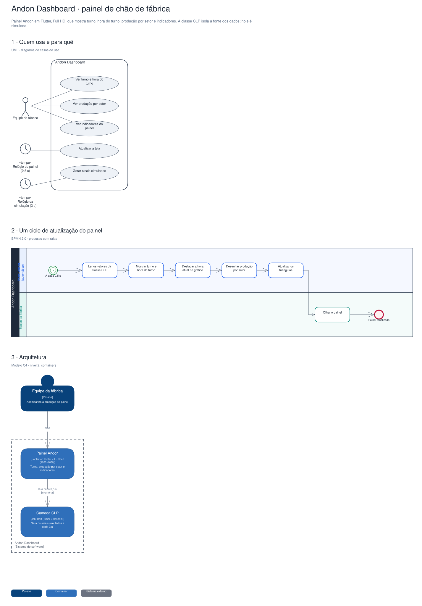

# Arquitetura

Diagramas gerados a partir do Sinapse (o segundo cérebro do Pedro). Cada projeto tem três vistas,
cada uma numa notação padrão:

1. **Quem usa e para quê**: UML, diagrama de casos de uso.
2. **O processo principal**: BPMN 2.0, com raias por quem executa.
3. **A arquitetura**: modelo C4, nível 2 (containers).

## Andon Dashboard · painel de chão de fábrica

Painel Andon em Flutter, Full HD, que mostra turno, hora do turno, produção por setor e indicadores. A classe CLP isola a fonte dos dados; hoje é simulada.

Editável: [`andon-dashboard-flutter.excalidraw`](./andon-dashboard-flutter.excalidraw), abre em [excalidraw.com](https://excalidraw.com) ou no VS Code com a extensão Excalidraw.

A fonte destes arquivos é o vault do Sinapse (`09-DESENHOS/`); alterações feitas aqui são sobrescritas na próxima publicação.
