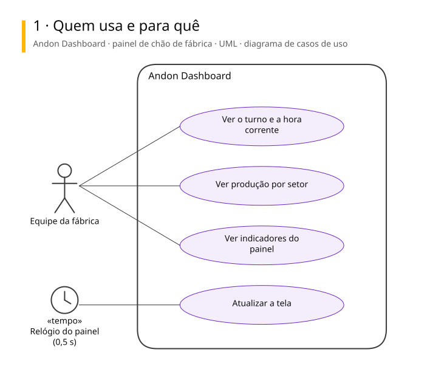
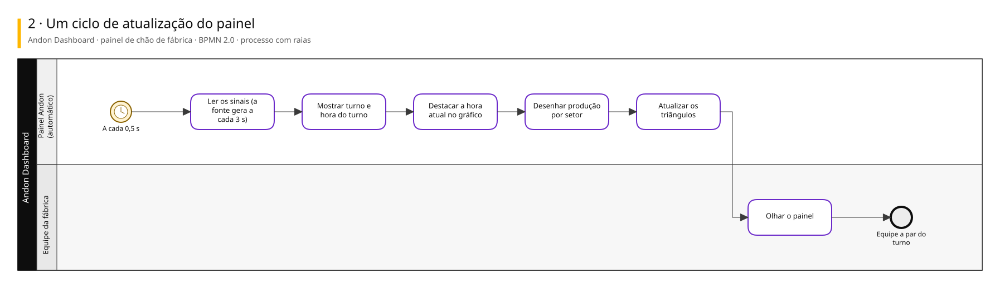
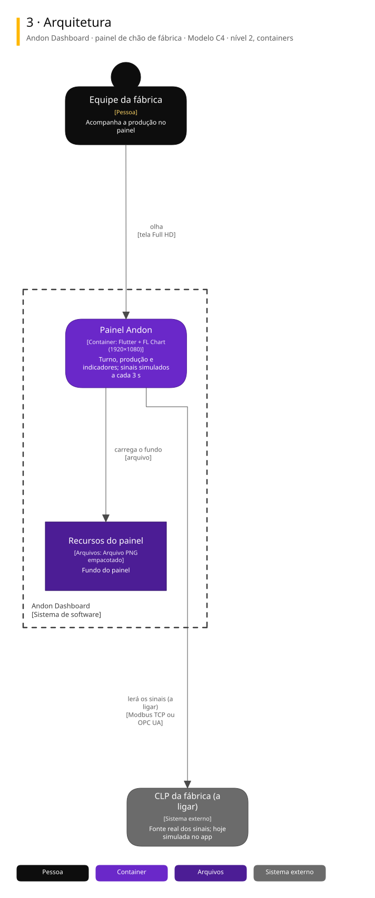

# Arquitetura

Três vistas do sistema, cada uma numa notação padrão.

| Vista | Notação | Responde |
|---|---|---|
| 1. Casos de uso | UML | Quem usa e para quê |
| 2. Processo | BPMN 2.0 | Como o trabalho anda, com uma raia para cada quem executa |
| 3. Arquitetura | C4, nível 2 | De que partes o sistema é feito e com quem conversa |

## Andon Dashboard · painel de chão de fábrica

Painel Andon em Flutter, Full HD, que mostra turno, hora do turno, produção por setor e indicadores. A fonte dos dados fica isolada dentro do app: hoje gera sinais simulados, e está pronta para trocar pelo CLP real.

### 1. Quem usa e para quê

### 2. Um ciclo de atualização do painel

### 3. Arquitetura

Para editar: [andon-dashboard.excalidraw](./andon-dashboard.excalidraw), que abre em [excalidraw.com](https://excalidraw.com) ou na extensão Excalidraw do VS Code.

## De onde vêm

Os diagramas são gerados a partir do Sinapse, o vault onde o Pedro organiza notas e projetos. Mudança feita direto aqui some na próxima publicação: o lugar de mudar é a especificação no Sinapse.
